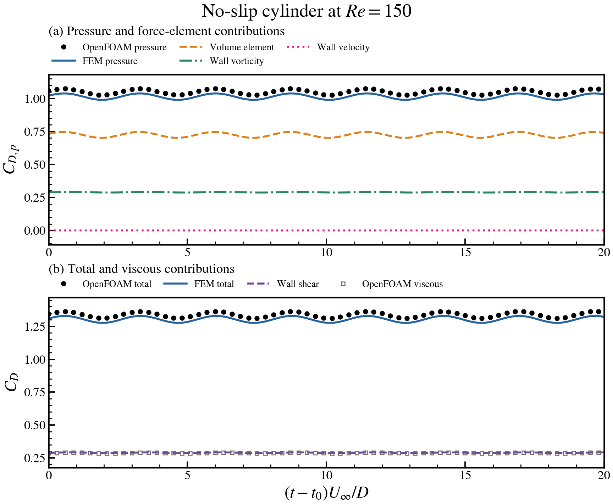
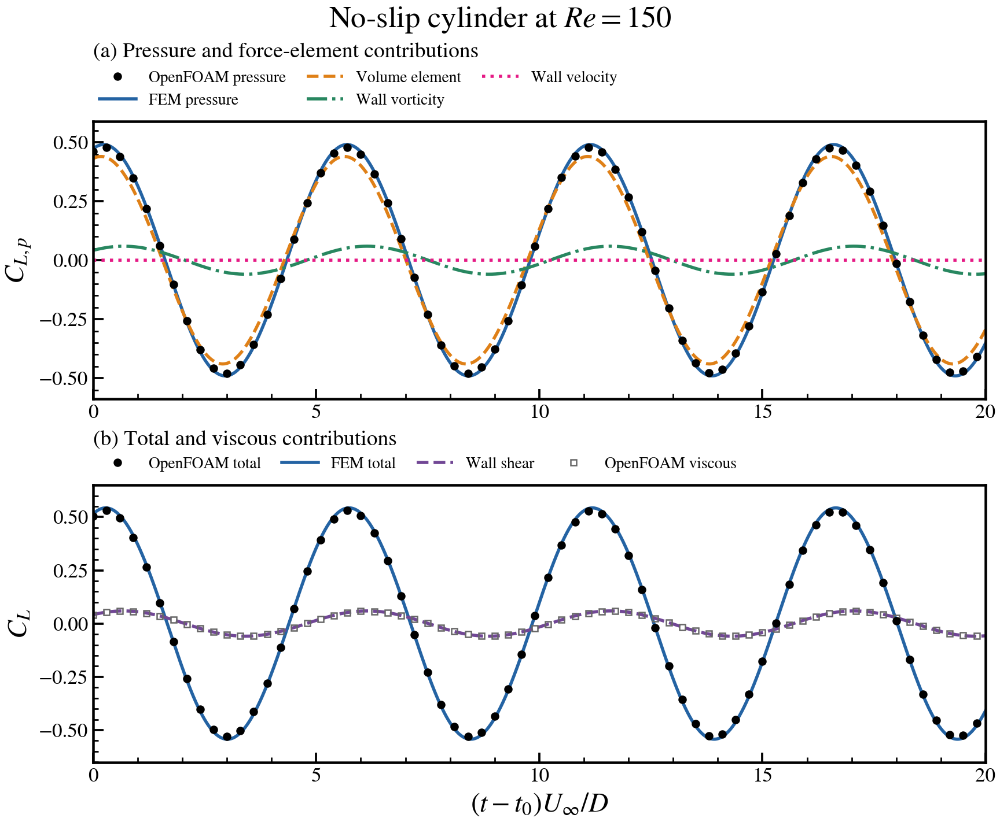
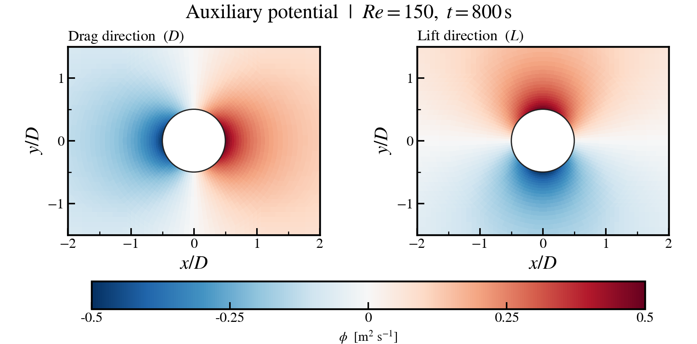
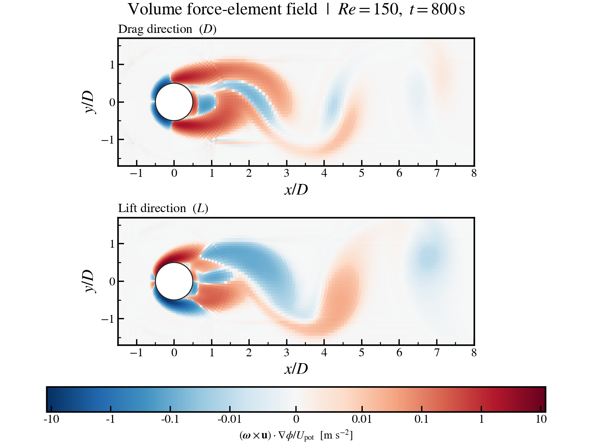

# 验证记录

整理日期：2026-10-21。

原始 `.C`、`.H`、`Make/files`、`Make/options` 未修改；使用 SHA-256 与来源逐项比对，校验清单见 `original-files.sha256`。

## 已完成的检查

- 四个原始文件与来源文件按字节及 SHA-256 比对一致。
- `Allwmake`、`Allwclean` 通过 shell 语法检查。
- 在独立副本中执行 `sh ./Allwmake`，完成编译及共享库链接，退出码为 0。
- 编译环境：WSL2 / Ubuntu 20.04、OpenCFD OpenFOAM v2306、GCC 9.4.0，`linux64GccDPInt32Opt`。
- 生成库：`libfieldFunctionObjects_USER_FEMAlterRotatingCylinder.so`；编译产物未纳入仓库。
- 上传文件清单检查、常见凭据模式检查和新增文件空白检查通过。

## Re=150时的无滑移圆柱

### 工况与数据

使用 `T0/Omega0` 的已有数值输出。运行日志记录了 OpenCFD OpenFOAM v2212 和 `icoFoam`。算例为二维静止、无滑移圆柱，圆柱直径和网格展向厚度均为 `1 m`，来流速度为 `1 m/s`，密度为 `1 kg/m³`，运动黏度为 `1/150 m²/s`，因此 `Re = 150`。阻力沿 `+x`，升力沿 `+y`，两者都对同一个 `wall` patch 积分。

以下路径相对于算例根目录。原始数据的 SHA-256 记录在[误差汇总](validation/omega0-summary.json)中。

| 输入文件 | 用途 |
| --- | --- |
| `postProcessing/FEMDrag/0/force_FEM.dat` | 阻力方向的力元积分 |
| `postProcessing/FEMLift/0/force_FEM.dat` | 升力方向的力元积分 |
| `postProcessing/forces/0/force.dat` | 压力力、黏性力和总力的壁面直接积分 |
| `postProcessing/forceCoeffs/0/coefficient.dat` | 对照用的 `Cd`、`Cl` 及归一化参数 |
| `Result_Ensight/Ensight_800/Omega0.case` | `t = 800 s` 的内部网格及势函数、体积力元场 |

### 重构和比较

静止圆柱在稳定来流下的重构力为 `F_FEM = SumFlowStructureContribution + SumWallVorticityContribution + SumWallShearStressContribution`。体积分的正负拆分用于检查 `SumFlowStructureContribution`。壁面速度项在所选窗口内全为零。三个积分项对应固定来流下的体积涡量、表面涡量和摩擦贡献。[Chang、Yang 和 Chu（2008），式 (3.5)–(3.6)](https://www.cambridge.org/core/journals/journal-of-fluid-mechanics/article/abs/manybody-force-decomposition-with-applications-to-flow-about-bluff-bodies/F9FA4A0E765BEFF1BC14AD92CA708298)

总力误差表沿用算例的 `forceCoeffs` 归一化口径，`C_FEM = F_FEM / (0.5 ρ U∞² Aref)`。从 `coefficient.dat` 的文件头读取 `U∞ = 1 m/s` 和 `Aref = 0.785398 m²`，得到参考力 `0.392699 N`。将 `forces` 输出的总力用同一个参考力归一化，与 `forceCoeffs` 的最大绝对差分别为 `6.26 × 10⁻¹³`（阻力）和 `1.77 × 10⁻¹³`（升力）。

比较窗口为 `700 ≤ t ≤ 800 s`，避开启动段。四个文件按 `Δt = 0.005 s` 的整数步号一一对应，共 `20,001` 个样本。允许 `10⁻⁸ s` 的文本写出时间误差，直接比较同一步的值。

### 结果

偏差定义为“重构值减参考值”的均值，归一化 RMSE 的分母为该窗口内参考系数的 RMS。升力逐点经过零值，因此使用整个窗口的 RMS 作为共同尺度。

| 系数 | 参考均值 | 重构均值 | 平均偏差 | RMSE | 最大绝对误差 | 归一化 RMSE |
| --- | ---: | ---: | ---: | ---: | ---: | ---: |
| `Cd` | 1.703857 | 1.659389 | −0.044468 | 0.044470 | 0.045580 | 2.61% |
| `Cl` | −0.009625 | −0.009834 | −0.000209 | 0.010736 | 0.015558 | 2.24% |

阻力重构存在约 `−0.0445` 的系统性偏差，均值低约 `2.61%`。升力波形接近壁面积分，重构的脉动 RMS 为 `0.489884`，比参考值 `0.479185` 高约 `2.23%`。两个方向的体积分正负拆分闭合误差均约为 `10⁻¹³ N`。

### 升阻力分量时序

两张图均展示 `780 ≤ t ≤ 800 s`，横轴从 `t₀ = 780 s` 起算，以 `(t − t₀)U∞/D` 表示。图中采用圆柱投影面积 `D × 展向厚度 = 1 m²`，各条曲线和 OpenFOAM 对照点统一除以 `0.5 N`。

每张时序图的上半部分用黑色圆点表示壁面压力积分，蓝色线表示体积元与壁面涡量项之和。橙色虚线、绿色点划线和洋红色点线分别表示体积元、壁面涡量和壁面速度项。壁面速度为零。下半部分给出总力重构、壁面剪切项及对应的直接积分。以图中的投影面积归一化，压力阻力和压力升力的 RMSE 分别为 `0.03671` 和 `0.00795`。

### 辅助势与体积力元场

两张场图采用 `t = 800 s` 时内部网格的单元值，在圆柱横截面显示。阻力和升力方向分别读取 `drag_*` 和 `lift_*` 字段。圆柱内部留白，两个方向使用相同的色标。

辅助势图使用 `drag_Potential` 和 `lift_Potential`，单位为 `m²/s`。以 EnSight 网格求得的单元中心代入圆柱解析势，两个方向与保存场的最大绝对差均为 `2.02 × 10⁻⁸ m²/s`。

体积力元图使用 `drag_FlowStructureContribution` 和 `lift_FlowStructureContribution`，单位为 `m/s²`。色标采用保留正负号的对称对数刻度，`±0.01 m/s²` 内为线性区。用全域的 97,732 个单元对该场乘密度后积分，与对应时序里的体积项对照。

| 方向 | 场积分（N） | 时序中的体积项（N） | 积分差值（N） |
| --- | ---: | ---: | ---: |
| 阻力 | 0.369301746 | 0.369301793 | −4.69 × 10⁻⁸ |
| 升力 | −0.147243586 | −0.147243579 | −6.62 × 10⁻⁹ |

本节评估的是单一静止工况、同一流场上两种力计算的闭合程度。历史运行日志记录了求解器版本，所用动态库的 Git 修订号未记录。旋转壁面、网格与时间步敏感性及实验对照需要各自的验证数据。

